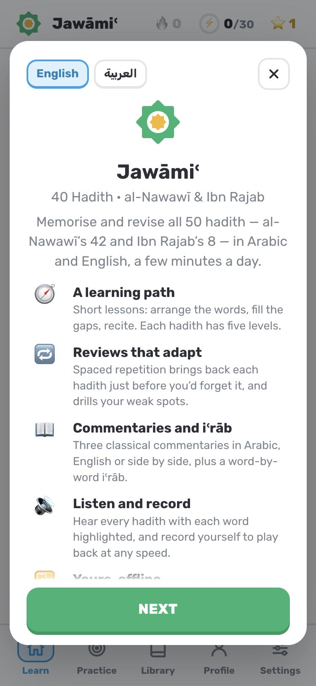
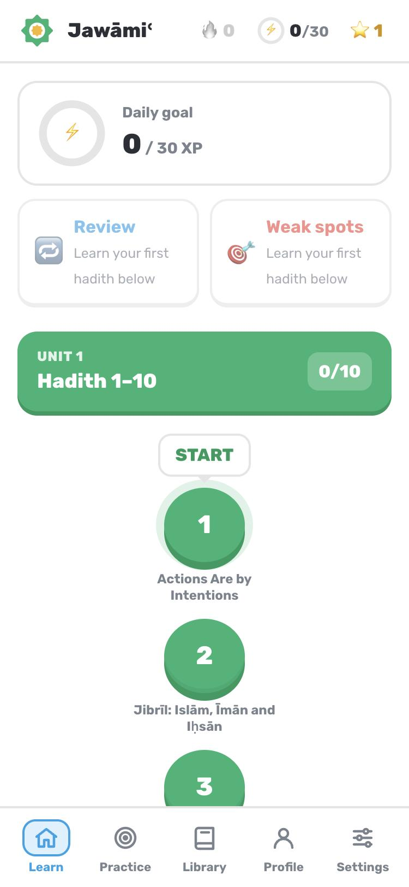
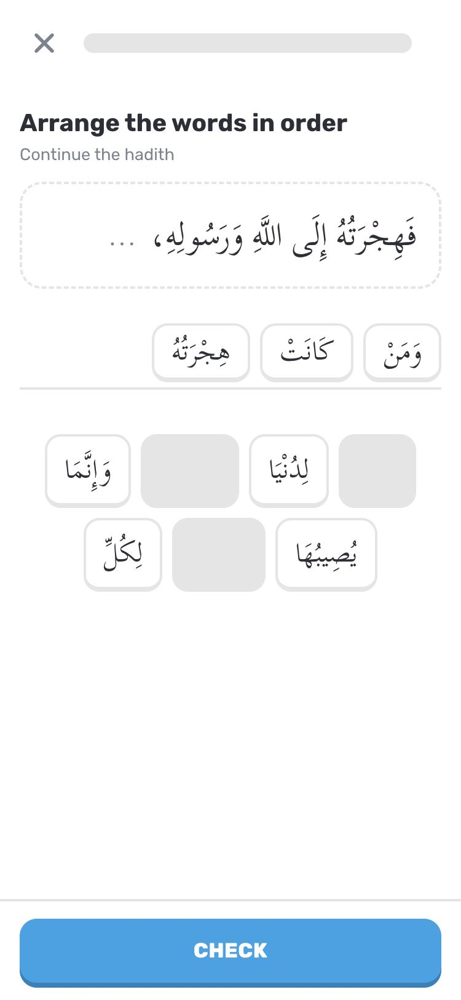
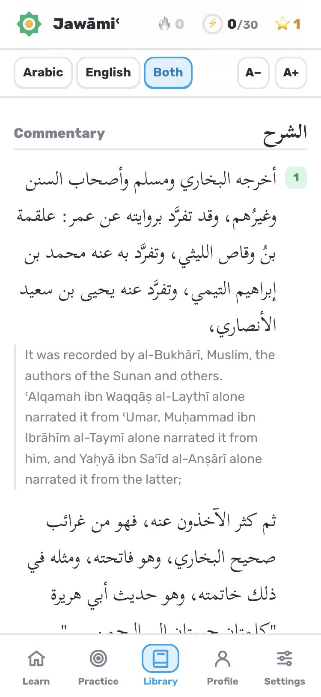
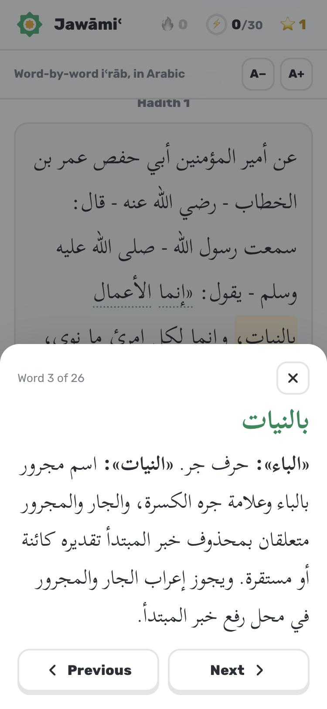

<div align="center">


# Jawāmiʿ · جوامع

**Memorise and revise the 40 Hadith — al-Nawawī’s 42 and Ibn Rajab’s 8 — in Arabic and English.**

### [Open the app → hollowbuzz.github.io/hadith40](https://hollowbuzz.github.io/hadith40/)

Free · no account · works offline · installable on your phone

</div>

<table>
  <tr>
    <td></td>
    <td></td>
    <td></td>
    <td></td>
    <td></td>
  </tr>
  <tr>
    <td align="center"><sub>Welcome</sub></td>
    <td align="center"><sub>Learning path</sub></td>
    <td align="center"><sub>Lessons</sub></td>
    <td align="center"><sub>Commentaries</sub></td>
    <td align="center"><sub>Iʿrāb</sub></td>
  </tr>
</table>

The name comes from *jawāmiʿ al-kalim*, the concise, comprehensive words these hadith are known for.

## What you can do

**Learn and review**
- Follow a learning path of 50 hadith in five units. Each hadith has five levels. Learning a hadith opens the next two, so you usually have a choice, and half of a unit opens the next unit.
- Short lessons with 13 kinds of question: arrange the words, fill the gap (tap or type with an Arabic keyboard), what comes next or before, the missing phrase, spot the wrong word, put the phrases in order, which hadith a phrase is from, hadith numbers, narrators, takhrīj, topics, and matching pairs.
- Questions rotate: what you haven’t seen comes first, and what you got wrong comes back sooner, so long hadith are covered part by part.
- Spaced repetition schedules each hadith for review, and *Weak spots* drills the hadith and facts you know least.
- On first visit, start from the beginning, tick the hadith you already know, or unlock everything.
- An optional **mufradāt path**: for each hadith, an overview of its key words and phrases as *al-Tuḥfah al-Rabbāniyyah* explains them, then a short test (word → meaning, meaning → word) with its own stars.

**Read and understand**
- Four commentaries on every hadith — *Fatḥ al-Qawī al-Matīn*, *al-Tuḥfah al-Rabbāniyyah*, *al-Sharḥ al-Mūjaz al-Mufīd*, and Ibn Rajab’s full *Jāmiʿ al-ʿUlūm wa-l-Ḥikam* — in Arabic, English, or each Arabic sentence with its English beneath. Jāmiʿ’s chapters load as you open them.
- A word-by-word iʿrāb of al-Nawawī’s 42 hadith: tap a word in the hadith to see its grammatical analysis.
- English translation of every hadith, with or without tashkeel, in your choice of Arabic font and size.

**Listen and recite**
- Recorded audio of every hadith, with each word highlighted as it is spoken. Tap a word to play from there.
- Memorise mode hides 25–100% of the words, or shows only their first letters.
- Record yourself reciting and play it back at 0.75×–2×.

**Yours**
- Arabic and English interface, light and dark themes.
- Progress stays in your browser; export a backup file and import it on another device.
- Works offline once loaded, and installs to the home screen.
- Daily goal, streaks, levels, achievements and a 60-second lightning round.

## Sources

| | Author | Original | In the app |
|---|---|---|---|
| The 50 hadith — *Mutūn Ṭālib al-ʿIlm*, level 1 | ed. ʿAbd al-Muḥsin al-Qāsim | [Shamela 570](https://shamela.ws/book/570/68) | Arabic text; English translated for this app |
| *Fatḥ al-Qawī al-Matīn* | ʿAbd al-Muḥsin al-ʿAbbād | [Shamela 11325](https://shamela.ws/book/11325) | Arabic + English (AI translation) |
| *al-Tuḥfah al-Rabbāniyyah* | Ismāʿīl al-Anṣārī | [Shamela 4469](https://shamela.ws/book/4469) | Arabic + English (AI translation) |
| *al-Sharḥ al-Mūjaz al-Mufīd* | ʿAbdullāh al-Muḥsin | [Shamela 8713](https://shamela.ws/book/8713) | Arabic + English (AI translation) |
| *Jāmiʿ al-ʿUlūm wa-l-Ḥikam* | Ibn Rajab (d. 795), ed. Māhir al-Faḥl | [Shamela 949](https://shamela.ws/book/949) | Arabic (editor’s footnotes left out) + English (AI translation) |
| *Iʿrāb al-Arbaʿīn al-Nawawiyyah* | ʿUmar al-ʿUmarī | [ketabonline 12753](https://ketabonline.com/ar/books/12753) | Arabic |
| Audio | Google Cloud Text-to-Speech (`ar-XA-Wavenet-B`) | — | generated with `tools/audio/` |

**Please note:** the English translations were made for this app with AI and have not yet been reviewed by a scholar. Check with a qualified teacher before relying on them. The books belong to their authors and publishers.

## Roadmap

- Meaning questions from the commentaries’ vocabulary and lessons.
- Listening questions using the recorded audio.
- An optional iʿrāb drill for Arabic learners.

## For developers

No build step and no dependencies: plain HTML, CSS and JavaScript modules. Serve the folder over HTTP (ES modules and service workers don’t work from `file://`):

```bash
python3 -m http.server 8000
```

Then open <http://localhost:8000>.

**Deploying:** the site is published with GitHub Pages from `main` (root). The service worker is network-first, so online visitors always get the latest files. When you change files, bump `VERSION` in `sw.js` (and in `js/app.js`): this refreshes the offline copy and shows returning users a “new version” prompt.

### Project layout

```
index.html            app shell (+ inline SVG icons)
css/app.css           all styles (light/dark, RTL/LTR, mobile/desktop)
js/app.js             router + views (path, practice, library, hadith page, profile, settings)
js/intro.js           first-visit introduction, "hadith I already know" picker
js/mufradat.js        mufradāt path: al-Tuḥfah vocabulary overview and tests
js/lesson.js          lesson runner, exercise screens, lightning round, end screens
js/quiz.js            question generators, session builders, rotation (unseen and missed prompts first)
js/srs.js             mastery facets, spaced repetition, strength and weak lists
js/sharh.js           commentary reader (four books × three reading modes) and book pages
js/iraab.js           iʿrāb reader (tappable words, entry sheet) and its book page
js/audio.js           recorded-audio player with word timings (falls back to the device voice)
js/recorder.js        record yourself and play back at any speed (IndexedDB)
js/text.js            Arabic normalisation, tokens, phrases, openings
js/store.js           localStorage state, XP/streak/level, export/import
js/i18n.js            English/Arabic UI strings
js/data.js            GENERATED hadith dataset (do not edit by hand)
js/render.js, ui.js, sound.js, achievements.js
sw.js, manifest.webmanifest, icons/, docs/screenshots/
data/shamela-raw.json raw text scraped from Shamela
data/commentaries/    the four commentaries, Arabic + English aligned by sentence (see its README)
data/iraab/           the iʿrāb of the 42 hadith, Arabic (see its README)
data/audio/           hadith recordings + index.json with word timings (see tools/audio/README.md)
tools/                build scripts: hadith data, commentaries, iʿrāb, audio
```

### Rebuilding the data

```bash
python3 tools/fetch_shamela.py   # re-download pages 71–132 of book 570 → data/shamela-raw.json
python3 tools/build_data.py      # merge with tools/meta.json → js/data.js
```

`tools/meta.json` holds the titles, short narrator names, takhrīj keys, English translations and editorial corrections. The build script splits each paragraph into narration, matn, Qurʾān and takhrīj segments, which the app colours differently.

The commentaries, iʿrāb and audio each have their own build script and README: [tools/commentaries](tools/commentaries/STYLE.md), [data/commentaries](data/commentaries/README.md), [data/iraab](data/iraab/README.md), [tools/audio](tools/audio/README.md).

### Notes on the text

- The Arabic is reproduced as it appears in the Shamela edition, including the edition’s spelling (for example «امْرِاءٍ»).
- **One correction:** in hadith 29, the Shamela text ends the quoted ayah with «يَعْلَمُونَ». The ayah (al-Sajdah 32:17) ends «يَعْمَلُونَ», so the app uses that word and shows a note on the hadith page. Edit or remove it under `corrections` in `tools/meta.json`.
